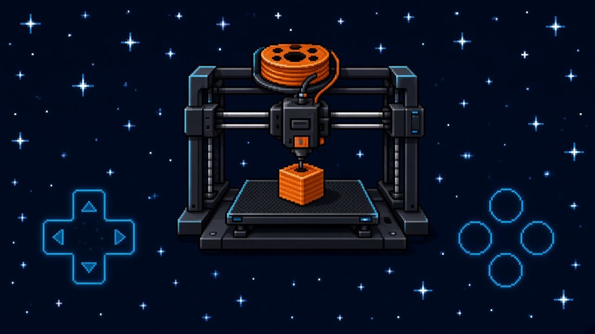

# PSP Remote 3DPrint



Мы тут с Grok решили запихнуть в PSP пульт управления для FDM-принтеров на MKS WiFi, а также локальное файловое хранилище и веб-слайсер. Но давайте пройдёмся по конкретике:
* файловое хранилище по локалке (модели на карте Memory Stick + HTTP);
* управление принтером: нагрев, охлаждение, пауза/продолжение, запуск печати;
* на десерт — встроенный веб-слайсер;
В планах немного переделать интерфейс как самого приложения, так и веб-страниц, добавить профили принтеров и больше возможностей для управления.

---

# PSP Remote 3DPrint


Grok and I decided to turn the PSP into a remote control for FDM printers over MKS WiFi, along with local file storage and a web slicer. Let's get into the specifics:
* local file storage (models on the Memory Stick + HTTP);
* printer controls: heating, cooling, pause/resume, and starting prints;
* and for dessert, a built-in web slicer.

Next, I plan to rework both the app and web interfaces a little, add printer profiles, and provide more printer controls.

---

## Build (Linux / WSL / macOS)

Install a matching official PSPDEV SDK and GNU Make, set `PSPDEV`, put `$PSPDEV/bin` on `PATH`,
then use a Node.js version that Vite supports:

```sh
cd web
npm ci
npm run build
cd ..
make dist
make DEBUG=1 dist
```

- Install artifact: `build/dist/EBOOT.PBP`
- `make DEBUG=1 dist` writes the same path with card logging (`-DFLSUN_DEBUG`, `log.txt`). Build release and DEBUG separately so they do not overwrite each other.
- On another OS or CPU, run `npm ci` instead of reusing `node_modules`
- `build.sh` runs the full web + PSP workflow

Copy `flsun.ini.example` to `PSP/GAME/FLSUNRemote/flsun.ini` and set the printer address.
Default `192.168.1.50` is a placeholder, not discovery. MKS TCP is 8080 and printer upload HTTP is 80.
The PSP web UI defaults to 8081. PPSSPP needs WLAN and local-network access.

`log=off` writes no diagnostic `last_m105.txt` / `last_m20.txt` and serves no log viewer.
`log=net` enables TCP 9999 and `/logs`. DEBUG builds append `log.txt` even when network logging is off.
The HTTP server has no authentication. Keep it on a trusted LAN.

## Testing

Host tests compile the C modules against the POSIX stand-ins in `tests/host`. They do not emulate PSP hardware.

```sh
python3 scripts/run_host_tests.py
HOST_SANITIZE=1 python3 scripts/run_host_tests.py
```

The suite covers config save and failed-write rollback, model-storage conflicts, printer snapshots and results, worker scheduling, socket deadlines, log cursors, MKS acknowledgement tokens, web-bundle checks, and splash geometry. Details and the sample G-code are in [docs/testing.md](docs/testing.md).

`cd web && npm ci && npm run build` builds the site. PSP firmware still needs the PSPDEV SDK (`make dist`, `make DEBUG=1 dist`). PPSSPP, a physical PSP, live MKS acknowledgement variants, the browser slicer, Memory Stick edge cases, and PSP-1000 memory limits are outside the host suite.

Queued heater-off is not an emergency stop — use the printer's physical controls when you need an immediate shutdown.

## Documentation

- [Architecture](docs/architecture.md)
- [Build](docs/build.md)
- [Configuration](docs/configuration.md)
- [HTTP and model storage](docs/http.md)
- [Printer link](docs/network.md)
- [Screens](docs/screens.md)
- [Web UI and license](docs/web.md)
- [Tests and sample files](docs/testing.md)

License: **GNU Affero General Public License v3.0** — see `LICENSE`. The served page embeds three-slicer 0.4.1 (AGPL-3.0-or-later), derived from OrcaSlicer. See `web/public/NOTICE-AGPL.txt`.
